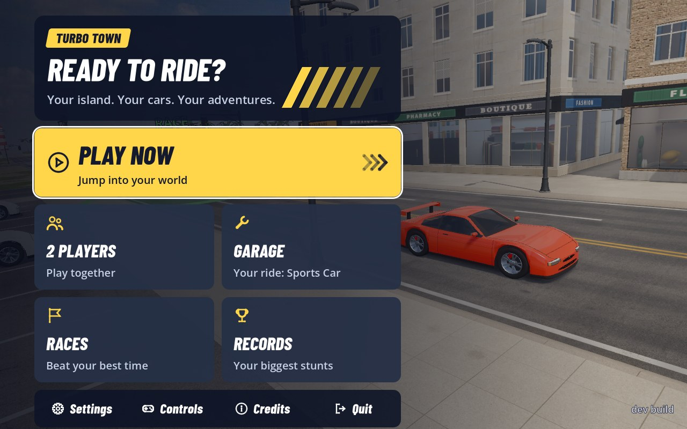
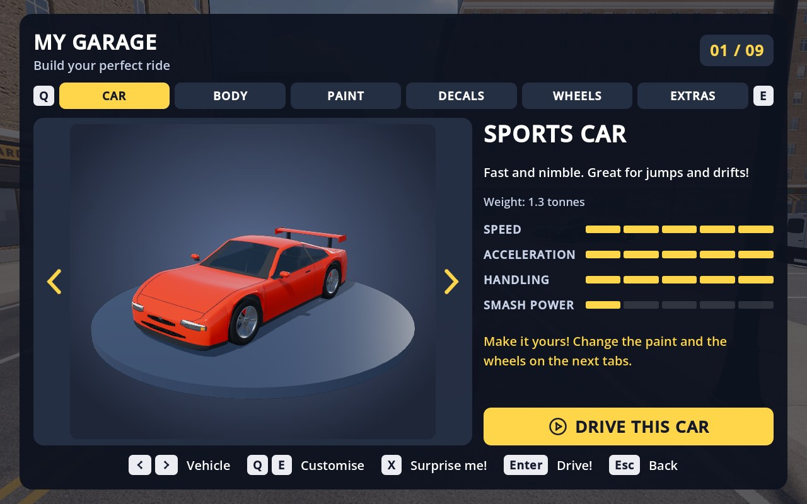

# Turbo Town

[](https://github.com/Fahmula/turbo-town/actions/workflows/release.yml)
[](https://github.com/Fahmula/turbo-town/releases/latest)

A stylized driving sandbox for the Steam Deck and Linux, made in Godot 4.7.
Explore a small island on foot, in any car, truck or bus you find, or in a
plane from the airfield. It has a city, a ring highway with overpasses, a
mountain road, dirt fields, a beach, a harbour and a stunt park full of
ramps. Crash, jump, race and customize your ride.

<p align="center">
  
  
</p>

**Contents:** [Play](#play) · [What's in the game](#whats-in-the-game) ·
[Controls](#controls) · [For developers](#for-developers)

| Document | What's in it |
|---|---|
| [CHANGELOG.md](CHANGELOG.md) | What's new in each release |
| [PROGRESS.md](PROGRESS.md) | Feature checklist, backlog and known issues |
| [RELEASING.md](RELEASING.md) | How releases are made; the Steam Deck install and updates |
| [ART_BIBLE.md](ART_BIBLE.md) | Art direction (stylized realism), asset rules, Steam Deck budgets |
| [ASSET_MANIFEST.md](ASSET_MANIFEST.md) | Every third-party asset: source, creator, licence |

## Play

### On the Steam Deck

In Desktop Mode, open Konsole and run:

```bash
curl -fLo /tmp/turbotown.sh https://github.com/Fahmula/turbo-town/releases/latest/download/turbotown.sh && bash /tmp/turbotown.sh install
```

This installs the game in `~/Games/TurboTown/`, adds it to the application
menu and to Steam (Library > Non-Steam), and keeps it on the newest release
from then on. Back in Game Mode, start it from Steam. Details are in
[RELEASING.md](RELEASING.md#steam-deck-install-and-auto-update).

### On a Linux PC

The same installer works on any x86_64 Linux. Or download
`TurboTown-vX.Y.Z-linux-x86_64.tar.gz` from the
[latest release](https://github.com/Fahmula/turbo-town/releases/latest),
extract it and run `TurboTown/TurboTown.x86_64`.

### From source

Open this folder in [Godot 4.7.2](https://godotengine.org/download) and press
**Play (F5)**. The game opens on the title screen. **PLAY NOW** puts you on foot
next to your vehicle, and Esc or Start opens the pause menu.

Settings, the garage and records are saved in
`~/.local/share/godot/app_userdata/Turbo Town/` (on Linux and the Steam Deck).
See [Saving](#saving).

## What's in the game

### The island

| Key | Teleport to |   | Key | Teleport to |
|---|---|---|---|---|
| 1 | City Center |   | 6 | Beach |
| 2 | Highway |   | 7 | Airfield |
| 3 | Stunt Park |   | 8 | Harbour |
| 4 | Mountain Top |   | 9 | Lighthouse |
| 5 | Dirt Fields |   | Tab | the next one |

On a gamepad, D-pad right teleports. Garage, teleports, respawn, traffic,
map, help and pause all work on foot too.

### On foot

- Walk up to any vehicle (yours, one parked in a lot, or a traffic car that
  has stopped) and the prompt says "Get in the ...". Press **F** (**B** on a
  gamepad).
- Inside, your character sits in the driver's seat with their hands on the
  wheel (a plane's pilot holds the stick), seen through the glass. A rider
  in split-screen sits beside them. The hood and cockpit views leave your own
  character out (the camera is in their head). Nobody shows in the bus,
  behind its dark glass.
- Press it again to get out. A moving vehicle stops first. You step out by
  the driver's door, or wherever there's room if a wall is in the way.
- Your vehicle stays where you left it, shown as a yellow square on the
  minimap and the island map. Teleporting on foot brings it with you, and the
  garage brings the one you pick to where you stand.
- An overturned vehicle offers "Flip it back over".
- Traffic stops for you (and honks if you stay in the road). A car that bumps
  into you just knocks you aside.

### Garage

Press **V** (D-pad down). Pick the sports car, sedan, van, delivery truck, bus,
pickup, buggy, monster truck or plane, and set it up. Switch tabs with Q / E
(LB / RB):

| Tab | What you can change |
|---|---|
| CAR | The vehicle (left / right) |
| BODY | Front and rear bumpers, side skirts, wheel arches, spoiler, bonnet, roof |
| PAINT | Colour, finish, two-tone and its second colour, racing stripes |
| DECALS | Side graphic, its colour, race number |
| WHEELS | Rims, rim colour, tyres, tyre stripe, brake caliper colour (the camera zooms in on a wheel) |
| EXTRAS | Underglow, horn |

- On every tab but CAR, up / down picks a row and left / right changes it. The
  camera turns to the part being changed.
- Rows that don't fit the shown vehicle are greyed out with the reason. Full
  body kits are on the sports car and sedan, and planes keep their own shape.
- **X / Y**: surprise me (a random vehicle, or random choices on the tab).
  **Enter / A**: drive (on foot, the vehicle is brought to you and you get
  in). **Esc / B**: back.
- Each vehicle keeps its own setup. Changes stick even when you back out, and
  everything is remembered the next time the game starts. The game is paused
  while the garage is open.

### Stunts

- Big air, flips, barrel rolls, air spins, drifts and near misses (squeezing
  past traffic) score points.
- Tricks chain into a combo with a multiplier. It's banked after a few seconds
  back on the wheels, or lost in a wipeout (landing on the roof) or a big crash.
- Let go of a flip or roll and the car turns itself level to land.
- Best combos and other records are on the RECORDS page.

### Races

- Six checkpoint races: City Sprint, Highway Loop, Mountain Climb, Trail Climb,
  Dirt Rally and Beach Dash.
- Drive into a green start circle and stop, or pick one on the RACES page.
- 3-2-1-GO, then drive through the gates in order. The next one is lit, an
  arrow over the car points at it, and the minimap marks it.
- Gold, silver and bronze times, and best times are saved.
- Backspace (or falling in the sea) puts you back at the last gate. END RACE in
  the pause menu stops it.

### Planes

- Three planes are parked on the airfield's apron (teleport 7). Walk up to one
  and get in like a car, or pick the Plane in the garage to be put on the
  runway (it isn't remembered as the vehicle you start with).
- Take off with full power, pulling back at about 80 km/h.
- With the assists on (the Assists setting, or T):
  - a let-go stick holds the climb or dive and eases it level;
  - turns don't lose height, and the wings come level;
  - full stick banks to 65 degrees (A / Space + stick rolls all the way round);
  - the plane won't stall when you let go;
  - low over the runway with the power off, it settles onto its wheels.
- R / Y in the air levels the plane where it is.
- You can't get out in the air: land, stop, then F / B.
- Teleports while flying take you there in the air (the Airfield puts you on
  the runway), and far out over the sea the plane turns back by itself.
- Races are for cars.

### Two players (split-screen)

- **Join:** pick 2 PLAYERS on the title screen (or ADD PLAYER 2 in the pause
  menu). Whoever pressed the button is player 1, with that controller plus the
  keyboard and mouse. Player 2 presses A on another controller, or Enter on
  the keyboard (then the keyboard is theirs).
- **The screen splits:** player 1 on top, player 2 below, each with their own
  camera, HUD, car and buttons. Each half is a wide strip: the camera keeps
  the full screen's sideways view and crops the top and bottom, and the HUD
  is a compact version.
- Player 2 starts on foot next to player 1 with their own car (a sedan until
  they pick one in the garage; their choice is remembered separately), and
  wears a blue T-shirt.
- A "P1" / "P2" marker floats over the other player, and both maps show them.
  X (0 on the keyboard, or R3) takes you to the other player; D-pad right /
  Tab teleports only you.
- **Ride along:** you can't take the other player's car (you can flip it back
  over), but you can walk up to it and press B (F) to sit in the passenger
  seat, parked or with the other player at the wheel, in any vehicle, the
  plane too.
  - The passenger watches through their own camera (the right stick looks
    around, RB / C cycles the views, and the close-up is from the passenger
    seat), sees the speed on their gauges and feels the bumps.
  - B gets them out once it has stopped (not in the air).
  - The driver's teleports take the passenger along. The passenger's own
    teleport, X or garage gets them out first.
- Traffic lives around both of you (the same number of cars as for one
  player), and two planes go side by side on the runway.
- Either player's Start pauses the game for both, and so does an unplugged
  controller. PLAYER 2: LEAVE (pause menu) or MAIN MENU ends split-screen.
- Races, instant replays and the crash cam are one-player only for now.

### Replays

- Press P (X on a gamepad) to watch the last 8 seconds again, with TV-style
  camera cuts.
- Big crashes play back by themselves in slow motion (the crash cam; switch it
  off in Settings).
- Enter / A skips. The game is paused while a replay plays and carries on
  exactly where it was.

### Weather

Clear, cloudy, rain, thunderstorms, or Changing (it drifts from one to the
next by itself). Rain soaks the roads, which shine, grow puddles and get a
little slippery, then dry off slowly; tyres throw up spray. Storms bring
lightning, thunder you hear a moment later, and turn the lights on. Pick it
in Settings.

### Settings

On the title screen or in the pause menu:

- traffic amount (few / normal / busy);
- graphics quality (low / medium / high / ultra);
- time of day (day / sunset / night / day & night cycle);
- weather (clear / cloudy / rain / thunderstorm / changing);
- speed units, driving assists, gamepad vibration, minimap, crash cam, speaker
  boost, flying controls, fullscreen and volume.

They're saved to `user://settings.cfg`. What is and isn't saved: see
[Saving](#saving).

## Controls

### On foot

| Action | Keyboard | Gamepad |
|---|---|---|
| Walk / run | W A S D / arrows | Left stick (a gentle push walks) |
| Sprint | Shift (hold) | L3 (click; lasts until you stop) |
| Walk slowly | Ctrl (hold) | |
| Jump | Space | A (Cross) |
| Get in a vehicle / flip one back over | F | B (Circle) |
| Look around | Mouse | Right stick |
| Camera distance | C | RB |

### Driving

| Action | Keyboard | Gamepad |
|---|---|---|
| Gas | W / Up | Right trigger |
| Brake / reverse | S / Down | Left trigger |
| Steer | A D / Left Right | Left stick |
| Handbrake | Space | A (Cross) |
| In the air: spin | A / D | Left stick |
| In the air: flip / barrel roll | Space + W S / A D | A + RT LT / left stick |
| Flip car upright | R | Y (Triangle) |
| Get out | F | B (Circle) |
| Horn | E | L3 |
| Instant replay | P | X (Square) |
| Camera view (chase / far / hood) | C | RB |
| Look back | Q | LB |
| Look around | Mouse | Right stick |
| Assists on/off (drift mode) | T | |
| km/h ↔ mph | U | |

### Flying (planes)

| Action | Keyboard | Gamepad |
|---|---|---|
| Power (hold; let go in the air and it cruises) | Shift | Right trigger |
| Slow down, flaps (brakes on the ground) | Ctrl | Left trigger |
| Bank left / right (steer on the ground) | A / D | Left stick |
| Nose up / down | S / W | Left stick back / forward |
| Loop | Hold S | Hold the stick back |
| Barrel roll | Space + A / D | A + left stick |
| Help! Level the plane (on the ground: flip upright) | R | Y (Triangle) |
| Get out (landed and stopped) | F | B (Circle) |
| Camera (chase / far / cockpit) | C | RB |
| Flying assists on/off | T | |

"Flying controls" in Settings swaps the nose: push up to climb instead of
pulling back.

### Anywhere

| Action | Keyboard | Gamepad |
|---|---|---|
| Garage: vehicle, body, paint, decals, wheels, extras | V | D-pad down |
| Teleport | 1-9, Tab = next | D-pad right |
| Back to spawn point | Backspace | Back / Select |
| Traffic on/off | G | D-pad up |
| Island map | M | D-pad left |
| 2 players: go to the other one | 0 | X / R3 |
| Help | H / F1 | |
| Pause menu | Esc | Start / Menu |

## For developers

You need [Godot 4.7.2](https://godotengine.org/download). Models are made
with [Blender](https://www.blender.org/) scripts, and textures and sounds
with Python 3 scripts (see [Assets and tools](#assets-and-tools)). The
generated files are committed, so you only need those tools to change them.

- [Project layout](#project-layout)
- [How things work](#how-things-work)
- [Adding things](#adding-things)
- [Testing](#testing)
- [Releases](#releases)

### Project layout

#### Scenes

| Scene | What it is |
|---|---|
| `scenes/main.tscn` | The game root: world, player car, camera, HUD. Game makes player 1's LocalPlayer at startup: the character, its cameras, the Possession |
| `scenes/player/player_character.tscn` | The walking character (model from `assets/models/character/`) |
| `scenes/vehicles/sports_car.tscn` | The default player car (physics, wheels, visuals, audio, effects, damage) |
| `scenes/vehicles/sedan.tscn`, `van.tscn`, `box_truck.tscn`, `bus.tscn`, `pickup.tscn` | Used by traffic and drivable from the garage (every vehicle scene is both) |
| `scenes/vehicles/buggy.tscn`, `monster_truck.tscn` | Garage only (AWD, long-travel suspension) |
| `scenes/vehicles/plane.tscn` | The sport plane (`Aircraft`), in the garage and parked at the airfield |
| `scenes/props/parked_plane.tscn` | A parked plane: a cheap prop, swapped for `plane.tscn` when you get in |
| `scenes/world/world.tscn` | Environment, sun, and the WorldBuilder that generates the map |
| `scenes/props/` | Cone, barrel, crate, bowling pin, lamp, traffic light, parked cars (drivable: `drive_scene`), and the parametric Ramp |
| `scenes/dev/physics_test.tscn` | A flat test track for tuning the car |

#### Scripts

| Folder | What's in it |
|---|---|
| `scripts/player/` | `local_player.gd` (one player on this machine: character, vehicle, rigs, HUD, input; two in split-screen), `player_input.gd` (one player's devices and actions), `possession.gd` (what the player controls; getting in and out), `controllable.gd` (component: who drives a pawn, which rig controls it), `player_character.gd` (walk / run / sprint / jump, kerbs, animation, footsteps, being bumped), `seat_figure.gd` (the character sitting in a vehicle, seen through the glass), `limb_ik.gd` (two-bone IK: hands on the wheel, feet in the footwell), `player_character_controller.gd` (input), `interactable.gd` (things you use with F / B), `vehicle_entry.gd` (a vehicle's doors and safe exit spots), `parked_car_entry.gd` (parked car props you can drive) |
| `scripts/vehicle/` | `aircraft.gd` (a plane: lift, drag, thrust, fly-by-wire controls and kid assists, propeller, control surfaces), `player_aircraft_controller.gd` (flying input), `vehicle.gd` (engine, gearbox, steering, assists), `vehicle_wheel.gd` (raycast suspension + tyre model), `player_vehicle_controller.gd` (input), `vehicle_body_visual.gd` (materials, lamps, indicators, grime, contact shadow), `vehicle_reflection.gd` (the player car's reflection probe), `vehicle_audio.gd`, `vehicle_effects.gd`, `vehicle_damage.gd`, `vehicle_catalog.gd` (the garage's vehicle list, blurbs, star ratings, stock wheel parts), `paint_palette.gd` (garage and traffic paints) |
| `scripts/vehicle/custom/` | `parts_catalog.gd` (everything the garage can change: tabs, slots, options, which vehicles a part fits), `loadout.gd` (one vehicle's setup: saved per vehicle, put on the car), `wheel_kit.gd` (fits rim + tyre parts to a vehicle's wheels), `body_kit.gd` (fits bumpers, skirts, arches, spoilers, bonnet and roof parts from the vehicle's kit), `underglow.gd` |
| `scripts/vehicle/audio/` | `vehicle_sound_profile.gd` (what a vehicle class sounds like), `vehicle_sound_bank.gd` (shared tyre / crash / glass sounds), `audio_director.gd` (traffic voice budget, Doppler) |
| `scripts/traffic/` | `traffic_network.gd` (lane graph built from the roads, turn curves, junctions, U-turns), `traffic_manager.gd` (spawning, signal timing), `traffic_driver.gd` (AI driver, turn signals), `traffic_light_prop.gd` |
| `scripts/camera/` | `chase_camera.gd` (driving), `flight_camera.gd` (flying), `on_foot_camera.gd` (walking), `camera_blend.gd` (glides between them), `menu_camera.gd` (title screen), `views.gd` (the cameras the players see through: one, or one per split-screen view) |
| `scripts/world/` | `map_layout.gd` (**all** the map's numbers); the terrain, road, city, nature, stunt park and landmark builders; `building_kit.gd`, `street_kit.gd`, `tree_kit.gd` (buildings, street furniture and trees, built in code); `mesh_builder.gd` (geometry helpers: bevelled boxes, lathes, sweeps, automatic LODs); `art_palette.gd` (world colours); `day_night.gd` (sun, real skies through the day, lights after dark); `sky_catalog.gd` (generated: each sky photo's sun and colours); `weather.gd` (clouds, rain, wet ground, wet grip), `rain_fx.gd` (rain round each camera), `lightning.gd` (bolts in a storm); `grass_field.gd` (3D grass tufts round the camera); `tree_scatter.gd`, `tree_lod.gd`, `tree_colliders.gd` (where trees grow, their LOD quadtree, trunk colliders); `night_light.gd`, `lighthouse_beam.gd` |
| `scripts/props/` | `prop.gd`, `kit_prop.gd` (props whose mesh comes from StreetKit), `ramp.gd` (`@tool`, editable in the editor) |
| `scripts/ui/` | `hud.gd`, `speedometer.gd`, `world_map.gd` (top-down island picture drawn at startup), `minimap.gd` (round heading-up minimap), `big_map.gd` (M), `vehicle_picker.gd` (the garage), `game_menu.gd` (title, pause, settings, controls pages), `ui_kit.gd` (the shared menu look) |
| `scripts/game/` | `game.gd` (title / driving / pause / garage states, spawning, teleports, respawn, changing vehicle), `graphics_quality.gd` (Low / Medium / High / Ultra), `stunt_tracker.gd` (tricks, combos, near misses, drifts), `race_catalog.gd` (race routes + medal times), `race_manager.gd` (gates, countdown, timing), `replay.gd` |
| `scripts/core/` | `input_setup.gd` (all key and gamepad bindings), `settings.gd` (the Settings autoload: saved player settings), `records.gd` (the Records autoload: best combos, biggest air...) |
| `scripts/dev/` | `dev_tools.gd` and the test scripts (see [Testing](#testing)) |

#### Assets and tools

| Path | What it is |
|---|---|
| `assets/models/` | `.glb` models from the Blender scripts (`character/player.glb` is the character) |
| `assets/shaders/` | `world_common.gdshaderinc` is shared; `vehicle/` has car paint, glass, lamps, trim and tyres |
| `assets/materials/` | `env/` has the world's materials |
| `assets/textures/` | Generated textures |
| `assets/audio/` | Built by `tools/audio/`; `profiles/` has one VehicleSoundProfile per vehicle |
| `tools/blender/` | One script per model, run as `blender -b -P tools/blender/<script>.py`: `make_car.py` (sports car), `make_sedan.py`, `make_van.py`, `make_pickup.py`, `make_truck.py` (delivery truck), `make_bus.py`, `make_buggy.py`, `make_monster.py` (monster truck), `make_wheels.py` (every rim and tyre), `make_plane.py` (the sport plane and its wheel), `make_kits.py` (body kits), `make_character.py` (the player character from Quaternius' CC0 Universal Animation Library: downloads it, rebuilds the mesh, keeps the animations); `body_kit.py` is the shared loft body builder and modelling helpers |
| `tools/textures/` | `make_textures.py` (ground detail, cloud and leaf textures), `make_decals.py` (garage decals), and `fetch_*.py`: download CC0 scans (Poly Haven, ambientCG) and make the game textures (`fetch_sky.py` real skies, `fetch_road.py`, `fetch_terrain.py`, `fetch_building.py`, `fetch_foliage.py`, `fetch_props.py`; shared helpers in `fetch_common.py`). Run them from the project root with `python3`, then import in Godot |
| `tools/audio/build_audio.py` | Every sound in `assets/audio/`: downloads the licensed recordings, makes loops, synthesizes the rest, writes the profiles (`python3 tools/audio/build_audio.py`) |
| `tools/release.sh`, `tools/steamdeck/` | The release build and the Steam Deck installer / launcher ([RELEASING.md](RELEASING.md)) |
| `ASSET_MANIFEST.md` | Every third-party asset: source, creator, licence, attribution |

### How things work

#### Vehicle physics

A `RigidBody3D` (Jolt physics, 120 Hz) with four raycast wheels. Each wheel
does spring / damper suspension and a slip-based tyre model with a friction
circle. `vehicle.gd` adds an automatic 5-speed gearbox, speed-sensitive
steering, anti-roll bars, drag and downforce, and kid-friendly assists
(traction control + stability control, gentle mid-air levelling) that can be
switched off with **T**.

#### The map

The map is generated from code at startup (about 0.4 s) using the numbers in
`scripts/world/map_layout.gd`. It's deterministic, so it's the same every run.

The builders are `@tool` scripts, so the island is also built in the editor:
open `scenes/main.tscn` (or `scenes/world/world.tscn`) to see it in the 3D
viewport. Those nodes have no owner, so they're never saved into the scene.
To change the map, edit `map_layout.gd` or a builder in `scripts/world/`,
then press **Rebuild map preview** in the World node's Inspector (untick
*Preview In Editor* if the editor ever feels slow).

#### Players and split-screen

Each player on this machine is a `LocalPlayer`
(`scripts/player/local_player.gd`): their character, vehicle, Possession,
the three rigs (on foot, driving, flying: a controller and a camera each),
HUD, stunt scoring and a `PlayerInput` (which devices are theirs). Game keeps
one, and its old single-player fields (`game.vehicle`, `game.camera`,
`game.teleport_to()`...) lead to player 1.

Split-screen (`Game.add_player` / `remove_player`) adds player 2:

- InputSetup gives each player a copy of the gameplay actions bound to just
  their devices (`p1_accelerate`, `p2_accelerate`...).
- `SplitScreen` makes two SubViewports sharing the one world. Each player's
  cameras and HUD move into their own, and the main viewport stops drawing
  the world. The views take no input: each LocalPlayer passes its own mouse
  look and camera button on.
- Everything in the world that follows "the camera" (grass, tree detail, the
  stars, traffic voices and Doppler, what's in sight) asks `Views`, which
  knows every player's camera. Grass and the "P1" / "P2" markers use render
  layers 19 / 20 so they only show in one view.
- Players' car sounds fade with distance in split-screen (two cameras
  listen). Traffic spawns around whichever player has fewer cars and
  despawns when it's far from both, with the same total.

Riding along: a vehicle's `VehicleEntry` keeps its passenger seats
(`riders`), and the Possession has a RIDING mode (`ride_with`, `leave_ride`).
No controller gets the vehicle, the player's own camera for that kind of
vehicle is aimed at it (`passenger` = the close-up view from the passenger
seat, `Vehicle.passenger_eye()`), and `focus_node()` is the vehicle, so
traffic, maps and the sea check follow it.

#### AI traffic

About 22 cars live around the player. They are ordinary `Vehicle`s driven by
a `TrafficDriver` instead of the player controller, so they crash, dent and
flip like your car.

- **Driving:** each driver follows a random route through a lane graph
  generated from the road polylines, steers with pure pursuit, and picks its
  speed with the Intelligent Driver Model (cars ahead, red lights and
  give-way points all count as "leaders").
- **Junctions:** city intersections with 3+ roads have demand-actuated
  traffic lights; left turns and merges give way. The east / west avenues
  cross the highway at signalized junctions with turns on and off in both
  directions.
- **Highway:** cars change lanes (overtake on the left, keep right) after a
  gap check.
- **You:** hit a traffic car hard and it gets stunned, then drives on or gives
  up; wrecks are removed once you look away. Cars you block honk at you.
  Honk and the car ahead pulls over or moves a lane right. Park in a lane and
  traffic drives around you through the oncoming lane when it's clear (trucks
  and buses wait instead).
- **Cost:** removed cars wait in a small pool per type and are reused
  (repaired and repainted), and drivers more than 140 m from the player update
  at half rate. `--bench` (with a window) prints spawn and render costs.
- **Tuning:** `max_cars`, spawn distances and the vehicle mix (`car_scenes` +
  `car_weights`) are on the `Traffic` node in `main.tscn`. Traffic is a mix of
  sports cars, sedans, vans, delivery trucks and buses. Each vehicle scene sets
  its own paint palette (`paint_palette` on its `Body` node) and AI speed
  (`ai_speed_factor`, `ai_max_accel` on the root).

#### Damage

Crash severity is the car's change of velocity over a quarter of a second.
Each car shares its model's mesh until its first dent, then gets its own
copy; the surface data is read from the GPU once per model and cached.

- Dents follow the hits (smooth falloff, normals bent so they show).
- Bumpers and spoilers lose health from nearby hits and fall off as debris
  (the models export them as separate meshes).
- Lights break at the end that was hit, and the glass cracks when the car is
  badly smashed.
- A smashed front costs up to half the engine power, pulls the steering
  slightly and smokes.
- Any reset (R, respawn, teleport, garage) repairs the car.

#### Vehicle looks

The models' materials are swapped by name for the vehicle shaders
(`assets/shaders/vehicle/`): car paint with a clear coat, metallic flop, road
grime and a damage layer (scuffs, primer and bare metal written into vertex
colours by `VehicleDamage`); glass with a crack web; lamps (headlights on at
night, brake, reverse, amber indicators); grilles and tyres. The player's car
reflects its real surroundings on Medium and High (`VehicleReflection`, a
probe re-captured every 14 m). Traffic signals before turns and lane changes
and puts its hazards on after a crash.

#### Vehicle sound

In `vehicle_audio.gd`, each vehicle's `VehicleSoundProfile` holds steady
engine loops recorded at known rpm, on and off load. The two either side of
the current rpm play pitched to it and crossfade, blended by throttle load,
plus start-up, turbo, pops, shifts, air brakes, beepers and a horn.

Shared sounds (`VehicleSoundBank`): tyre roll per surface, squeal, gravel,
wind, scraping, crash tiers by strength and what was hit, glass, suspension
knocks, splashes, and reverb in tunnels. Traffic uses a lighter version, and
the `AudioDirector` lets only the nearest 6 cars play their loops (with
Doppler). Sources and licences: [ASSET_MANIFEST.md](ASSET_MANIFEST.md), and
CREDITS in the menus.

#### Replay

`scripts/game/replay.gd` records the player's body and wheel transforms and
nearby traffic 60 times a second (a 10 s ring buffer). It then poses them
from the recording while the tree is paused, and puts the live state back
afterwards. Damage, debris and props aren't recorded. The crash cam is
triggered by `VehicleDamage.crashed` (severity ≥ 0.5).

#### Player character and vehicles

The player controls a *pawn*: the character or a vehicle (`scripts/player/`).

- **Controllable:** anything controllable has a `Controllable` component
  (Vehicle and PlayerCharacter add one) that says who drives it right now (the
  player's `Possession`, a `TrafficDriver`, or nobody) and its `kind`.
- **Rigs:** the `kind` picks a *rig*, the input controller and camera for that
  kind: `PlayerCharacterController` + `OnFootCamera`,
  `PlayerVehicleController` + `ChaseCamera`, and `PlayerAircraftController` +
  `FlightCamera` for planes. Only one rig has a pawn at a time, so the
  character and a vehicle can never both take input, and a traffic car is
  first taken off its driver (`TrafficManager.claim`). A boat later would be a
  new kind with its own controller and camera (`Possession.add_rig`).
- **Getting in:** the `Interactable` nearest the character (a vehicle's
  `VehicleEntry`, a parked car's `ParkedCarEntry`) shows its prompt. F / B
  walks the character to the door for a moment while the `CameraBlend` glides
  to the chase camera, then sits it down (`PlayerCharacter.sit_in`) and hands
  the vehicle the controls.
- **In the seat:** the walking character is hidden and a `SeatFigure` (a copy
  of its model, same clothes) sits in the vehicle: the driving clip for the
  driver, the sitting clip for a passenger. `LimbIK` (two-bone IK) puts the
  hands on the steering wheel and the feet in the footwell, from each
  vehicle scene's Seats settings (`seat_hip`, `seat_recline`, `seat_feet`,
  `steering_wheel`...; the cabins in the Blender generators are laid out
  round them). It's a child of the vehicle, so it moves with it, copies the
  body's roll, and is kept out of the owner's own hood / cockpit view.
  `Game.adopt_vehicle` points the HUD, maps, traffic, stunts, replay,
  headlights, reflections and full engine sound at it.
- **Getting out:** the vehicle brakes to a stop and `VehicleEntry.find_exit`
  picks a spot: the driver's door, then the other side, behind, in front,
  rings further out, the roof. Each needs walkable ground at about the same
  height, room for the capsule and no wall between the seat and it. The
  vehicle is parked (handbrake, engine off, quiet sound) and the camera glides
  back keeping its heading.
- **Parked vehicles:** vehicles you left stay parked. Up to three older ones
  are kept, and they go when far away and out of sight.
- **Collisions:** characters are on physics layer 4, and vehicles don't
  collide with them (a car would hit a person like a wall). Instead the
  character is shoved aside by anything that drives into it, and traffic
  drivers stop for it (`TrafficManager.pedestrians`).

#### Flying

A plane (`aircraft.gd`) is a `Vehicle`, so damage, sound, getting in and out,
the HUD, maps and replays work as for a car. Its engine turns a propeller.

- Each tick it computes lift from the wing's angle of attack (falling off past
  a 15 degree stall), drag, a side force and propeller thrust (fading with
  airspeed and above 530 m). Three raycast wheels carry it on the ground.
- The controls are fly-by-wire. The stick asks for g (the wing's angle of
  attack is chosen to give it, never past the stall) and for a roll rate or
  (with assists on) a bank angle. The nose follows the airflow, so banking
  turns the plane, and authority grows with airspeed.
- The model's moving parts (propeller, blur disc, ailerons, flaps, elevator,
  rudder) are found by name.
- The `FlightCamera` lags behind the plane, leans with part of the bank, and
  follows fully when steep or upside down.

#### Saving

There are two files in `user://` (on Linux and the Deck,
`~/.local/share/godot/app_userdata/Turbo Town/`):

| File | What's in it |
|---|---|
| `settings.cfg` (the `Settings` autoload) | The options *and* the player's garage: which vehicle they drive (`vehicle`) and every vehicle's setup (`loadouts`: vehicle id → only the parts that differ from stock, so new garage slots and parts need no save changes) |
| `records.cfg` (`Records`) | Best combos, biggest air, longest drift, most flips, near misses, total score and race best times |

The dev audio panel writes `audio_mix.cfg`. Both autoloads load at startup,
save on every change, type-check what they read, and migrate older formats in
`load_file()`. Dev and test runs (any command-line user argument) never read
or write them.

Not saved: where you are, on foot or in a vehicle (every session starts at the
City Center beside your vehicle), damage, traffic, parked vehicles you left,
and the session's stunt score.

New saved state goes in the same places. An option or a choice about the
player's things is a key in `Settings.DEFAULTS` (typed, with a default).
Customization follows `Loadout`'s overrides-of-stock pattern, and a record
goes in `Records`. If progress grows (unlocks, money, character outfits,
several profiles), move the player's things (`vehicle`, `loadouts`) to a
`user://profile.cfg` with a one-off migration in `load_file()`.

#### Pausing and input

- `Game` always processes (menus, input), so it sets its gameplay children
  (world, traffic, the player car, camera, stunts, races) to pausable.
  Anything that should run in menus sets its own process mode.
- All bindings are registered in `scripts/core/input_setup.gd`. Any action you
  define in Project Settings > Input Map overrides the default.

### Adding things

#### A new car

Duplicate one of the scenes in `scenes/vehicles/`, swap the models under
`Body` and the wheel `Visual` nodes, then tweak the exported values on the
root (engine, gears, brakes, steering) and on each wheel (radius, springs,
grip, which wheels steer and drive). Set `paint_color` on the `Body` node for
a new colour and `driver_eye` on the root for the hood camera. Add it to
`scripts/vehicle/vehicle_catalog.gd` to make it appear in the garage (with
the `rims` / `tyres` its wheel model is made of). The chase camera frames
bigger vehicles automatically (from their collision boxes).

#### Garage parts

- **A rim or tyre:** a builder in `tools/blender/make_wheels.py` (rims are
  built to one standard fit, see its docstring) plus an entry in
  `PartsCatalog.RIMS` / `TYRES`. Colours are entries in the other lists there.
- **A body part:** a builder in `tools/blender/make_kits.py` (a mesh named
  `<slot>_<id>` in the vehicle's kit) plus an entry in
  `PartsCatalog.BODY_PARTS` (with `on` = the vehicles it fits).
- **A decal:** a strip in `tools/textures/make_decals.py` plus an entry in
  `PartsCatalog.DECALS`.
- **A new kind of customization** (exhausts, window tint...) is a slot: add it
  to `PartsCatalog.SLOTS` and a tab in `TABS`, give it a stock value in
  `Loadout._stock_values()` and put it on the car in `Loadout.apply()`. The
  garage builds its rows from the catalog, and saving works for any slot.

#### A ramp

Instance `scenes/props/ramp.tscn` in any scene and edit its shape, length,
height and width in the Inspector. It rebuilds live in the editor.

#### Map changes

Edit `map_layout.gd`: the city grid, block types, highway size and bridge
height, mountain, hill road control points, dirt mounds...

### Testing

The tests are dev modes of the game. Run them from the project root like
this:

```bash
godot --path . -- --garage=/tmp/shots
```

- Every mode in the next two tables takes a folder for its screenshots, like
  `--garage=/tmp/shots`.
- "Pass / fail" tests print an `ok` or `FAIL` line per check and a summary.
- Add `--graphics=0..3` (Low / Medium / High / Ultra) to run any of them at
  that quality.
- Add `--vehicle=<id>` (`sedan`, `van`, `box_truck`, `bus`, `pickup`, `buggy`,
  `monster_truck`) to run a main-game test in another vehicle.
- Add `--weather=<clear|cloudy|rain|storm|changing>` to start any of them in
  that weather.
- Add `--audio-driver Dummy` (before the `--`) to keep a test silent. The game
  still mixes its sound, so `--audio` can record it.

#### Gameplay (pass / fail)

| Mode | What it checks |
|---|---|
| `--garage` | The garage menu, customizing, and changing into every vehicle |
| `--parts` | Every body part on every vehicle, finishes, two-tone, decals, numbers, underglow (shots), then fit, crash / repair, save and leak checks. `--vehicles=a,b` for only those vehicles' parts |
| `--wheels` | Every rim, rim colour, tyre and tyre stripe in the garage and on the road (shots for review) |
| `--onfoot` | The character: walk / run / sprint / jump, in and out of every vehicle type (keyboard + gamepad), traffic and parked cars, exits by walls, overturned and damaged vehicles, being bumped, garage / teleport / race / sea on foot, leak check |
| `--split` | Two players: joining with a second gamepad, each player's own controls (simulated pads 0 and 1), views, cars, teleports, X to the other player, garage, planes, traffic around both, pause, leaving and rejoining |
| `--ride` | Two players, one riding along with the other: getting in and out, cameras, no controls, teleports, the sea, garage swaps, the plane, leaving |
| `--seats` | The players sitting in vehicles: getting in and out, the hood / cockpit view leaves your own character out, replays, teleports, garage swaps, the bus, the plane, a split-screen passenger in player 2's T-shirt, player 2 leaving |
| `--flight` | The plane: take-off, cruise, turns, loop, roll, stall, the help button, teleports, the island's edge, landing, getting out and in, replay, parked planes, taxiing, crash, garage. Run with `--fixed-fps 60` |
| `--menus` | Title, pause, settings and controls menus driven by input |
| `--stunts` | Air, flips, rolls, spins, drift, near miss, wipeout → combos and records |
| `--races` | The race flow, plus an autopilot drives every race (medal reference times) |
| `--replay` | Pausing freezes everything, instant replay, the slow-motion crash cam |
| `--damage` | Crashes into walls: parts off, lights and glass, pull, power, repair |
| `--night` | Sunset, night and the day / night cycle: lights switch (+ shots) |
| `--weather-test` | Every weather, soaking and drying, wet grip and spray, rain under the overpass, lightning, storm lights, Changing, split-screen rain |

#### Driving and the world (shots)

| Mode | What it does |
|---|---|
| `--tour` | Screenshots from the spawn points and viewpoints |
| `--drive` | An autopilot lap of the highway, park, city and mountain |
| `--park` | The loop-the-loop (4 vehicles) and the wall-ride bowl |
| `--trail` | The buggy and pickup drive the mountain trail to the summit |
| `--landmarks` | Drives through the tunnel, over the bridge, down the runway and onto a pier (+ views) |
| `--map` | Minimap and big map screenshots (+ `world_map.png`) |
| `--scenery` | Fixed city and bridge views at day / sunset / night and Low / High, with draw calls, primitives and GPU time per view. `--views=a,b`, `--quick`, `--hours=6.4,9,18.2`, `--ultra`, `--stress`, `--profile`, `--traffic-on` narrow or measure |
| `--lookdev` | Every vehicle from fixed cameras at day / sunset / night. `--vehicles=a,b --views=front34,rear34,side,wheel,chase,lamps --times=day --damaged` |
| `--charsheet` | The character from fixed cameras at day / sunset / night, plus animation strips |
| `--seatsheet` | A driver and a passenger in every vehicle, cut open and from outside, with how far hands and feet fall short and the headroom. `--vehicles=a,b --views=none --try=z,y,recline,wheel z,wheel y;...` tries other seat numbers |
| `--fx` | Effects: a drift in the stunt park (tyre smoke) and a crash into a building at speed (dents) |

#### Traffic

The commands are what goes after `godot --path .`.

| Command | What it does |
|---|---|
| `-- --traffic=<dir>` | Watch traffic for 150 s, logging speeds, stuck cars and crashes |
| `-- --rampage=<dir>` | The player drives the wrong way into traffic |
| `-- --showcase=<dir>` | One of each traffic vehicle in a filmed convoy |
| `-- --lanes=<dir>` | Passing a parked player, horn reactions, highway lane changes |
| `-- --junction=<dir>` | The highway / avenue junction for 150 s: turns used, crashes, jams |
| `--headless --fixed-fps 120 -- --spawncheck` | 60 traffic spawns; none may crash |
| `--headless --fixed-fps 120 -- --corner=/tmp` | Each vehicle laps the highway with lane changes (roll check) |
| `--headless --fixed-fps 120 -- --uturn=/tmp` | A car U-turns at a dead end |
| `--headless -s res://scripts/dev/traffic_graph_check.gd` | Lane graph sanity |
| `--headless -s res://scripts/dev/terrain_road_check.gd` | Terrain poking through roads |

#### Physics

```bash
godot --path . --headless --fixed-fps 120 res://scenes/dev/physics_test.tscn -- --autotest=accel
```

Scenarios: `rest`, `accel`, `brake`, `turn`, `fastturn`, `handbrake`, `jump`,
`wall`, `rollover`. Add `--vehicle=res://scenes/vehicles/bus.tscn` to test
another vehicle.

#### Performance

The commands are what goes after `godot --path .`. All but the first need a
window. `--gpu-index 0` uses a weak integrated GPU, the closest stand-in for
the Steam Deck on a PC.

| Command | What it measures |
|---|---|
| `--headless --fixed-fps 120 -- --bench` | Physics cost with and without traffic, spawn cost |
| `--fixed-fps 120 -- --bench` | The same, plus real spawn and render costs |
| `--gpu-index 0 -- --perfsweep=<dir>` | GPU cost of each graphics effect, Medium / Low, trees and grass, standing and driving |
| `--gpu-index 0 --resolution 1280x800 -- --splitbench=<dir>` | One view vs split-screen: GPU and frame time, draw calls at Low / Medium / High (`--levels=0,1 --views=city_city`) |
| `--gpu-index 0 -- --flightbench=<dir>` | GPU cost flying over the city at 60, 150 and 300 m, Medium / Low / High |
| `-- --onfootbench` | The character's cost: draw calls, CPU and GPU with it shown and hidden, physics time |
| `-- --seatbench` | A seated character's cost while driving: draw calls, CPU and GPU with it shown and hidden, animation and IK time |
| `-- --partsbench` | A fully kitted player car against a stock one: GPU and draw calls |

#### Sound

The commands are what goes after `godot --path .`.

| Command | What it does |
|---|---|
| `--headless -s res://scripts/dev/audio_check.gd` | Every vehicle's sound profile loads and covers its rev range |
| `--audio-driver Dummy -- --audio=<dir>` | A scripted drive recorded to `session.wav` (+ the traffic voice budget). Then `python3 tools/audio/check_recording.py <dir>` looks for clicks, dropouts, clipping and levels. `--stems` records one file per mix bus, `--speakers=on\|off` the Deck or flat mix |
| `--audio-driver Dummy -- --mixpanel=<dir>` | The dev audio mix panel (F8 in the game) |

### Releases

Stable builds for the Steam Deck are GitHub Releases, made by
[release-please](https://github.com/googleapis/release-please) and GitHub
Actions. Merging the release PR (`chore(main): release X.Y.Z`) is the
release: Actions builds the game, smoke-tests it and only then publishes it.
PR titles use Conventional Commits (`feat:`, `fix:`...), and each PR's
description carries its player-facing release notes. Pull requests into
`main` get a test build. Everything else (versioning, writing release notes,
what to do when a build fails, the Steam Deck launcher) is in
[RELEASING.md](RELEASING.md).
